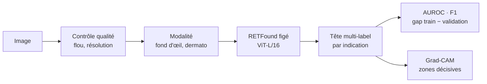

# Visual Health Platform

[](https://github.com/sumarc183-design/visual-health-platform/actions/workflows/ci.yml)

[](https://docs.astral.sh/ruff/)
[](https://colab.research.google.com/github/sumarc183-design/visual-health-platform/blob/main/notebooks/colab_baseline_retfound.ipynb)

Socle modulaire d'analyse d'images médicales. Premier cas d'usage : dépistage
multi-pathologies sur images de fond d'œil, avec
[RETFound](https://github.com/rmaphoh/RETFound_MAE) (modèle fondamental
rétinien préentraîné) comme backbone. Chaque nouvelle indication ajoute une
tête spécialisée sur le socle commun, sans le reconstruire.



## Résultats

Backbone `RETFound_mae_natureCFP` figé, tête linéaire multi-label (30 epochs),
images 224×224, Colab GPU T4.

| Date | Données | Classes | Split | AUROC macro |
|---|---|---|---|---|
| 2026-11-02 | RFMiD | 28 | train / val officiels (1 920 / 640) | **0,855** |
| 2026-11-03 | RFMiD | 27 (PTCR absent du test) | train / **test** officiels (1 920 / 640) | **0,832** |
| 2026-11-02 | ODIR-5K, étiquettes patient | 8 | par patient, 85/15 (5 439 / 953) | **0,806** |
| 2026-11-03 | ODIR-5K, étiquettes par œil (défaut actuel) | 8 | même split | **0,845** |

- **Très bien reconnues** (AUROC > 0,93 sur RFMiD) : rétinopathie diabétique,
  DMLA, myopie, occlusions veineuses. Les classes très rares en validation
  ont une AUROC instable.
- **Test RFMiD** : 0,832, à 0,02 de la validation (0,854 sur les mêmes 27
  classes) : le chiffre de validation n'était pas optimiste. Gap train − test
  +0,14 et F1 macro 0,24 au seuil 0,5 : seuils par classe et calibration
  au programme de J60. Détail par classe : [`results/`](results/).
- **ODIR** : le diagnostic patient recopié sur les deux yeux étiquetait faux
  20,8 % des images ; le loader utilise désormais l'étiquette de l'œil
  photographié ([explication](docs/GUIDE.md#odir-5k)). Gain : 0,806 → 0,845, toutes
  les classes progressent, surtout O (0,647 → 0,747), la plus mal étiquetée
  avant. Étiquettes changées en entraînement et en évaluation, même split.
- Sonde sur backbone figé, pas le fine-tuning complet des chiffres publiés
  par RETFound : attendre quelques points de moins.

## Démarrage rapide

**Sans installation** : bouton *Open in Colab* ci-dessus, `GPU T4`, token
HuggingFace dans les Secrets Colab (`HF_TOKEN`), `Tout exécuter`.

**En local** (poids RETFound et données : voir le [guide](docs/GUIDE.md#poids-retfound)) :

```bash
pip install -r requirements-dev.txt
python run_baseline.py --dataset rfmid --data-root <chemin RFMiD> \
    --checkpoint third_party/retfound/checkpoints/RETFound_mae_natureCFP.pth --epochs 30
pytest tests/                   # unitaires + bout-en-bout sur images synthétiques
```

## État du socle

| Étape | État |
|---|---|
| 1. Contrôle qualité (flou, résolution) | 🟡 Testé, signale sans filtrer (seuil de flou à calibrer) |
| 2. Identification de la modalité | 🟡 Architecture en place, pas encore entraînée |
| 3. Prétraitement fond d'œil | ✅ Normalisation ImageNet, 224×224 |
| 4. Classification multi-label | ✅ RFMiD et ODIR, AUROC mesurée |
| 5. Localisation des zones suspectes | ⬜ J60 |
| 6. Explicabilité (Grad-CAM) | 🟡 Planches [RFMiD](results/gradcam_rfmid.png) et [ODIR](results/gradcam_odir.png) : chaleur surtout sur la bordure et le fond noir, rarement sur les lésions (sauf cataracte) ; test d'occlusion prêt (`scripts/occlusion_examples.py`), à lancer pour trancher (artefact ViT ou raccourci) |
| 7. Score de confiance calibré | ⬜ J60 |

## Données

| Base | Usage |
|---|---|
| RFMiD | Fond d'œil, 28 pathologies (phase 1) |
| ODIR-5K | Fond d'œil, 8 classes, volume complémentaire (phase 1) |
| ISIC | Dermatologie, seconde modalité (phase 2) |
| AI-Hub | Dépistage TSA depuis la rétine (phase 2/3, accès à négocier) |

Arbitrage des cas d'usage : [docs/USE_CASES.md](docs/USE_CASES.md).

## Structure

```
run_baseline.py         point d'entrée : contrôle qualité -> RETFound -> tête -> AUROC
src/pipeline/           contrôle qualité, identification de modalité
src/data/               loaders RFMiD et ODIR (structure Kaggle réelle)
src/models/             backbone RETFound, tête de classification
src/explainability/     Grad-CAM adapté aux ViT
src/eval/               métriques multi-label (AUROC, F1)
scripts/                poids RETFound, Grad-CAM, données, générateur synthétique
notebooks/              notebook Google Colab
tests/                  tests unitaires, bout-en-bout synthétique, données réelles
results/                sorties des runs réels
configs/                hyperparamètres de référence (non lus par les scripts)
docs/                   guide, carte du modèle, roadmap, cas d'usage
```

## Documentation

| Document | Contenu |
|---|---|
| [GUIDE.md](docs/GUIDE.md) | Installation, poids, données, exécution, Grad-CAM, tests |
| [MODEL_CARD.md](docs/MODEL_CARD.md) | Usage prévu, données, métriques, limites |
| [ROADMAP.md](docs/ROADMAP.md) | Jalons J30 / J60 / J90 |
| [USE_CASES.md](docs/USE_CASES.md) | Arbitrage entre fond d'œil, dermatologie et TSA |
| [CHANGELOG.md](CHANGELOG.md) | Historique des versions |

## Licences et attributions

⚠️ **RETFound est sous licence CC BY-NC 4.0** : recherche et usage non
commercial uniquement, pas dans un produit commercial sans licence des
auteurs. Détails et options : [THIRD_PARTY_NOTICES.md](THIRD_PARTY_NOTICES.md).
Pour citer ce travail : [CITATION.cff](CITATION.cff).

Projet de recherche, pas un dispositif médical.
