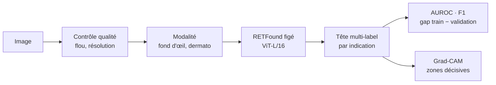

# Visual Health Platform

[](https://github.com/sumarc183-design/visual-health-platform/actions/workflows/ci.yml)

[](https://docs.astral.sh/ruff/)
[](https://colab.research.google.com/github/sumarc183-design/visual-health-platform/blob/main/notebooks/colab_baseline_retfound.ipynb)

Socle modulaire d'analyse d'images médicales. Premier cas d'usage : dépistage
multi-pathologies sur images de fond d'œil, avec
[RETFound](https://github.com/rmaphoh/RETFound_MAE) (modèle fondamental
rétinien préentraîné) comme backbone. Chaque nouvelle indication ajoute une
tête spécialisée sur le socle commun, sans le reconstruire.



## Résultats

Backbone `RETFound_mae_natureCFP` figé, tête linéaire multi-label (30 epochs,
graine 42), images 224×224, prétraitement `crop-mask` (recadrage sur la
rétine + masque commun), GPU T4 (Colab ou Kaggle). Entre crochets : IC à
95 % par bootstrap, sur les patients pour ODIR, sur les images pour RFMiD
(qui ne fournit pas d'identifiant patient).

| Date | Données | Classes | Split | Validation | **Test** |
|---|---|---|---|---|---|
| 2026-11-04 | RFMiD | 28 (27 en test, PTCR absent) | officiels (1 920 / 640 / 640) | 0,864 [0,840-0,891] | **0,846** [0,813-0,886] |
| 2026-11-04 | ODIR-5K, étiquettes par œil | 8 | par patient 70/15/15 (4 474 / 953 / 965) | 0,861 [0,841-0,880] | **0,848** [0,816-0,873] |

Le test n'a été lu qu'une fois par jeu, après le choix du prétraitement sur
la validation. Ses chiffres sont compatibles avec l'IC de la validation : rien
n'indique un optimisme marqué de la validation, sans que cela le prouve.
Le test ODIR est un hold-out constitué le 3 novembre, **après** les premières
explorations : il est disjoint du train actuel (par patient), mais ses images
faisaient partie du train des runs antérieurs (split 85/15). Une confirmation
indépendante demandera des données externes.

**Choix du prétraitement**, par différence d'AUROC appariée sur les mêmes
images de validation (`scripts/compare_predictions.py`,
[RFMiD](results/compare_rfmid_val.json), [ODIR](results/compare_odir_val.json)) :

| | `none` (redimensionnement direct) | `crop-mask` | Différence [IC 95 %] |
|---|---|---|---|
| RFMiD | 0,858 | 0,864 | +0,006 [−0,005 ; +0,021], non significative |
| ODIR | 0,840 | 0,861 | **+0,020 [+0,011 ; +0,030]** |
| ODIR, DMLA | 0,857 | 0,900 | **+0,043 [+0,001 ; +0,092]** |

`crop-mask` ne coûte rien sur RFMiD et gagne sur toutes les classes d'ODIR
(significativement pour Normal, Diabète, Glaucome et DMLA), tout en
réduisant nettement le raccourci d'acquisition sur les exemples examinés
(voir [Explicabilité](#explicabilité)).

- **Très bien reconnues** (AUROC test > 0,94) : rétinopathie diabétique,
  DMLA, trous maculaires, myopie (RFMiD) ;
  cataracte et myopie (ODIR). Les classes à moins de 10 positifs ont un IC
  trop large pour conclure (signalées dans [`results/`](results/)) : par
  exemple RP, AUROC test 1,0 avec 2 positifs, est une preuve insuffisante,
  pas une performance parfaite.
- **AUROC ≠ décisions** : l'AUROC mesure le classement, indépendamment du
  seuil. Au seuil 0,5, le F1 macro n'est que de 0,26 sur RFMiD (0,48 sur
  ODIR) : les maladies rares dépassent rarement 0,5. Seuils par classe
  choisis sur la validation, sensibilité/spécificité et calibration au
  programme.
- **Écart train/test de la tête** sur RFMiD (AUROC 0,98 contre 0,85) : un
  balayage d'une cinquantaine de réglages (régularisation, pondération des
  classes, standardisation, durée ;
  [script](scripts/sweep_head.py), [RFMiD](results/sweep_head_rfmid.json),
  [ODIR](results/sweep_head_odir.json)) n'apporte pas de gain démontré sur la
  validation : meilleurs écarts +0,003 (RFMiD) et +0,007 (ODIR), maxima de
  144 mesures, donc biaisés vers le haut. L'origine de la limite (features
  figées, classes très rares) reste une hypothèse.
- Sonde sur backbone figé, pas le fine-tuning complet des chiffres publiés
  par RETFound : attendre quelques points de moins.

<details>
<summary>Historique (prétraitement <code>none</code>, 2 et 3 novembre)</summary>

| Date | Données | Split | AUROC macro |
|---|---|---|---|
| 2026-11-03 | RFMiD, validation | officiel | 0,858 |
| 2026-11-03 | RFMiD, test (27 classes) | officiel | 0,832 |
| 2026-11-02 | ODIR, étiquettes patient | par patient 85/15 | 0,806 |
| 2026-11-03 | ODIR, étiquettes par œil | par patient 85/15 | 0,845 |

ODIR : le diagnostic patient recopié sur les deux yeux étiquetait faux
20,8 % des images ; le loader utilise l'étiquette de l'œil photographié
([explication](docs/GUIDE.md#odir-5k)), d'où 0,806 → 0,845. Le passage au
split 70/15/15 (moins d'images d'entraînement) rend ces chiffres non
comparables aux résultats actuels.
</details>

## Explicabilité

Grad-CAM s'allume surtout sur le fond noir et les bords : il est trompeur
sur ce modèle (tokens « artefacts » des ViT MAE). L'explication de référence
est le **test d'occlusion**, qui cache des zones de l'image et mesure la
chute de la prédiction ([RFMiD](results/occlusion_rfmid_crop-mask.png),
[ODIR](results/occlusion_odir_crop-mask.png)).

Avec le redimensionnement direct ([avant](results/occlusion_odir.png)), la
DMLA d'ODIR prenait un **raccourci** : 92 % de l'effet d'occlusion tombait
hors de la rétine. ODIR mélange 87 formats d'image, dont certains très liés
à une maladie (60 % des 3456×3456 sont des glaucomes) : la forme de l'ovale
trahissait l'appareil. `crop-mask` donne la même géométrie à toutes les
images, et, sur les exemples examinés, l'effet revient sur la rétine :

| Classe | Effet hors rétine, `none` → `crop-mask` | Zones qui comptent (exemples examinés) |
|---|---|---|
| DMLA (A, ODIR) | 92 % → **5 %** | ✅ la région maculaire |
| DMLA (ARMD, RFMiD), RS | 34-39 % → 1-6 % | ✅ macula, lésions visibles |
| Myopie (MYA, M) | 15-37 % → 13-25 % | ✅ atrophie péripapillaire, effet diffus |
| Glaucome (G, ODIR) | 39 % → 32 % | 🟡 surtout le disque optique, en partie les bords |
| Cataracte (C) | — | ✅ le voile de toute l'image (aucune zone isolée ne compte) |

Hors rétine, toutes les images sont désormais noires et de même forme : ce
qui reste d'effet sur les bords ne peut plus trahir l'appareil par la
géométrie.

**Portée de ces mesures** : 3 images par classe, choisies parmi les positifs
les mieux prédits, avec un seul réglage d'occlusion (carré gris de 32 px).
Elles illustrent ; elles ne prouvent ni que le raccourci a disparu sur toute
la population (l'appareil peut aussi laisser des différences de couleur, de
netteté ou d'éclairage dans la rétine), ni que les zones utilisées sont les
lésions. À confirmer sur des cas tirés au hasard, erreurs comprises, avec
plusieurs réglages d'occlusion et la relecture d'un ophtalmologue. Méthode :
[GUIDE](docs/GUIDE.md#contrôle-par-occlusion),
[prétraitement](docs/GUIDE.md#prétraitement-commun-crop-mask).

## Démarrage rapide

**Sans installation** : bouton *Open in Colab* ci-dessus, `GPU T4`, token
HuggingFace dans les Secrets Colab (`HF_TOKEN`), `Tout exécuter`.

**En local** (poids RETFound et données : voir le [guide](docs/GUIDE.md#poids-retfound)) :

```bash
pip install -r requirements-dev.txt
python run_baseline.py --dataset rfmid --data-root <chemin RFMiD> \
    --checkpoint third_party/retfound/checkpoints/RETFound_mae_natureCFP.pth --epochs 30
pytest tests/                   # unitaires + bout-en-bout sur images synthétiques
```

## État du socle

| Étape | État |
|---|---|
| 1. Contrôle qualité (flou, résolution) | 🟡 Testé, signale sans filtrer (seuil de flou à calibrer) |
| 2. Identification de la modalité | 🟡 Architecture en place, pas encore entraînée |
| 3. Prétraitement fond d'œil | ✅ Normalisation ImageNet, 224×224 |
| 4. Classification multi-label | ✅ RFMiD et ODIR, AUROC mesurée |
| 5. Localisation des zones suspectes | ⬜ J60 |
| 6. Explicabilité | 🟡 Grad-CAM peu fiable sur ce ViT (chaleur sur le fond) ; l'occlusion le remplace. Voir [Explicabilité](#explicabilité) |
| 7. Score de confiance calibré | ⬜ J60 |

## Données

| Base | Usage |
|---|---|
| RFMiD | Fond d'œil, 28 pathologies (phase 1) |
| ODIR-5K | Fond d'œil, 8 classes, volume complémentaire (phase 1) |
| ISIC | Dermatologie, seconde modalité (phase 2) |
| AI-Hub | Dépistage TSA depuis la rétine (phase 2/3, accès à négocier) |

Arbitrage des cas d'usage : [docs/USE_CASES.md](docs/USE_CASES.md).

## Structure

```
run_baseline.py         point d'entrée : contrôle qualité -> RETFound -> tête -> AUROC
src/pipeline/           contrôle qualité, identification de modalité
src/data/               loaders RFMiD et ODIR (structure Kaggle réelle)
src/models/             backbone RETFound, tête de classification
src/explainability/     Grad-CAM adapté aux ViT
src/eval/               métriques multi-label (AUROC, F1)
scripts/                poids RETFound, Grad-CAM, données, générateur synthétique
notebooks/              notebook Google Colab
tests/                  tests unitaires, bout-en-bout synthétique, données réelles
results/                sorties des runs réels
configs/                hyperparamètres de référence (non lus par les scripts)
docs/                   guide, carte du modèle, roadmap, cas d'usage
```

## Documentation

| Document | Contenu |
|---|---|
| [GUIDE.md](docs/GUIDE.md) | Installation, poids, données, exécution, Grad-CAM, tests |
| [MODEL_CARD.md](docs/MODEL_CARD.md) | Usage prévu, données, métriques, limites |
| [ROADMAP.md](docs/ROADMAP.md) | Jalons J30 / J60 / J90 |
| [USE_CASES.md](docs/USE_CASES.md) | Arbitrage entre fond d'œil, dermatologie et TSA |
| [CHANGELOG.md](CHANGELOG.md) | Historique des versions |

## Licences et attributions

⚠️ **RETFound est sous licence CC BY-NC 4.0** : recherche et usage non
commercial uniquement, pas dans un produit commercial sans licence des
auteurs. Détails et options : [THIRD_PARTY_NOTICES.md](THIRD_PARTY_NOTICES.md).
Pour citer ce travail : [CITATION.cff](CITATION.cff).

Projet de recherche, pas un dispositif médical.
