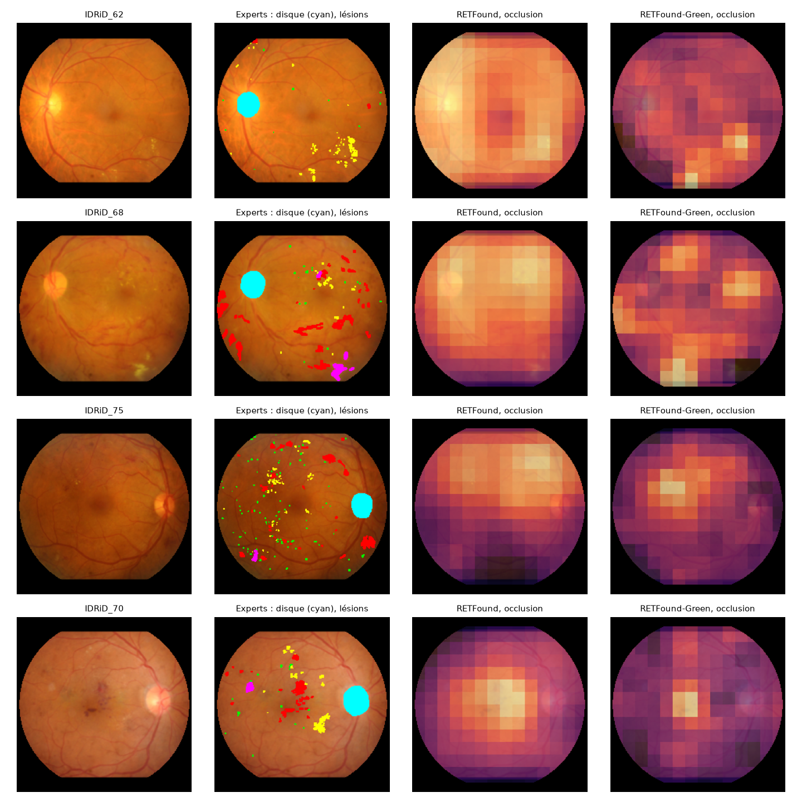
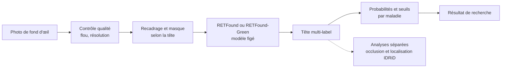

# Visual Health Platform

[](https://github.com/sumarc183-design/visual-health-platform/actions/workflows/ci.yml)

[](https://docs.astral.sh/ruff/)
[](LICENSE)
[](https://colab.research.google.com/github/sumarc183-design/visual-health-platform/blob/main/notebooks/colab_baseline_retfound.ipynb)

Pipeline de recherche pour analyser les photos de fond d'œil avec
[RETFound](https://github.com/rmaphoh/RETFound_MAE) et
[RETFound-Green](https://github.com/justinengelmann/RETFound_Green) : contrôle
qualité, classification multi-pathologies et analyse des zones utilisées par
les modèles. Les têtes sont entraînées sur RFMiD et ODIR, puis évaluées en
transfert sur APTOS et EyePACS.

> *In English:* a research pipeline for retinal fundus photographs, built on the
> RETFound and RETFound-Green foundation models: quality control, multi-label
> disease classification, external validation on APTOS and EyePACS, and lesion
> localisation measured against expert masks (IDRiD). Not a medical device; the
> documentation is in French.

## En bref

- **Baseline multi-pathologies** : AUROC macro de **0,846 sur RFMiD** et
  **0,848 sur ODIR**, avec une tête linéaire sur RETFound figé.
- **Fine-tuning partiel** : AUROC macro de **0,873 sur le test RFMiD**, contre
  0,846 pour la tête figée ; le gain ne se retrouve pas sur EyePACS.
- **Transfert de rétinopathie diabétique** : Green atteint une AUROC de
  **0,726 sur EyePACS**, contre 0,661 pour RETFound, avec les têtes RFMiD
  comparées dans l'expérience.

[](#localisation-des-lésions)

*Quatre images IDRiD tirées au hasard. De gauche à droite : l'image, les masques
d'experts (disque optique en cyan), puis les zones dont le masquage fait chuter le
score de RETFound et de RETFound-Green.*

**Limites** : projet de recherche, sans validation clinique. Les seuils choisis
sur une base se transfèrent mal à une autre ; les résultats dépendent des
maladies, des données et du protocole. La localisation IDRiD est évaluée
séparément et ne produit pas de segmentation dans `predict.py`.

[Résultats détaillés](#résultats) · [Explicabilité](#explicabilité) ·
[Localisation IDRiD](#localisation-des-lésions) ·
[Décisions et calibration](#décisions-et-calibration) · [Guide](docs/GUIDE.md)

## Démarrage rapide

**Sans installation** : ouvrir le [notebook Colab](https://colab.research.google.com/github/sumarc183-design/visual-health-platform/blob/main/notebooks/colab_baseline_retfound.ipynb),
choisir un GPU T4, ajouter `HF_TOKEN` aux Secrets Colab, puis exécuter les cellules.

**En local, avec les poids, la tête et les seuils préparés** :

```bash
python predict.py mon_fond_d_oeil.jpg --head heads/odir_crop-mask_head.pt \
    --checkpoint third_party/retfound/checkpoints/RETFound_mae_natureCFP.pth \
    --thresholds results/decision_odir.json --policy f1
```

Installation, préparation des données, entraînement des têtes et exemple Green :
[guide d'utilisation](docs/GUIDE.md). Les poids et les têtes sont à préparer
séparément ; ils ne sont pas inclus dans le dépôt.

## Parcours actuel



`predict.py` choisit le backbone et le prétraitement enregistrés dans la tête.
Le contrôle qualité peut signaler ou refuser une image ; l'occlusion et la
localisation sont exécutées par des scripts distincts. Le fine-tuning est
un parcours expérimental séparé. Grad-CAM reste disponible pour comparaison.

## Résultats

Backbone `RETFound_mae_natureCFP` figé, tête linéaire multi-label (30 epochs,
graine 42), images 224×224, prétraitement `crop-mask` (recadrage sur la
rétine + masque commun), GPU T4 (Colab ou Kaggle). Entre crochets : IC à
95 % par bootstrap, sur les patients pour ODIR, sur les images pour RFMiD
(qui ne fournit pas d'identifiant patient).

| Date | Données | Classes | Split | Validation | **Test** |
|---|---|---|---|---|---|
| 2026-11-04 | RFMiD | 28 (27 en test, PTCR absent) | officiels (1 920 / 640 / 640) | 0,864 [0,840-0,891] | **0,846** [0,813-0,886] |
| 2026-11-04 | ODIR-5K, étiquettes par œil | 8 | par patient 70/15/15 (4 474 / 953 / 965) | 0,861 [0,841-0,880] | **0,848** [0,816-0,873] |

Le test n'a été lu qu'une fois par jeu, après le choix du prétraitement sur
la validation. Ses chiffres sont compatibles avec l'IC de la validation : rien
n'indique un optimisme marqué de la validation, sans que cela le prouve.
Le test ODIR est un hold-out constitué le 3 novembre, **après** les premières
explorations : il est disjoint du train actuel (par patient), mais ses images
faisaient partie du train des runs antérieurs (split 85/15). Une confirmation
indépendante demandera des données externes.

**Choix du prétraitement**, par différence d'AUROC appariée sur les mêmes
images de validation (`scripts/compare_predictions.py`,
[RFMiD](results/compare_rfmid_val.json), [ODIR](results/compare_odir_val.json)) :

| | `none` (redimensionnement direct) | `crop-mask` | Différence [IC 95 %] |
|---|---|---|---|
| RFMiD | 0,858 | 0,864 | +0,006 [−0,005 ; +0,021], non significative |
| ODIR | 0,840 | 0,861 | **+0,020 [+0,011 ; +0,030]** |
| ODIR, DMLA | 0,857 | 0,900 | **+0,043 [+0,001 ; +0,092]** |

`crop-mask` ne coûte rien sur RFMiD et gagne sur toutes les classes d'ODIR
(significativement pour Normal, Diabète, Glaucome et DMLA), tout en
réduisant nettement le raccourci d'acquisition sur les exemples examinés
(voir [Explicabilité](#explicabilité)).

**Fine-tuning partiel** (5 novembre ; 4 derniers blocs du ViT + tête,
augmentations de couleur et de géométrie, configuration fixée à l'avance ;
[script](scripts/finetune_retfound.py), [analyse](scripts/finetune_analysis.py),
[résultats](results/finetune_analysis.json)). Différences appariées avec la
tête linéaire, sur les mêmes images :

| | Tête linéaire | Fine-tuning partiel | Différence [IC 95 %] |
|---|---|---|---|
| RFMiD, validation | 0,864 | 0,893 | **+0,029 [+0,011 ; +0,047]** |
| RFMiD, test (lu une fois) | 0,846 | 0,873 | **+0,026 [+0,014 ; +0,041]** |
| APTOS, AUROC globale (RD) | 0,827 | 0,974 | +0,148 [+0,135 ; +0,160] |
| APTOS, à format égal (RD) | 0,941 | 0,929 | −0,012 [−0,026 ; +0,002] |

Le gain sur RFMiD est net. Sur APTOS (jamais vu à l'entraînement), le gain
global vient **entièrement** des comparaisons entre formats d'image : à
format égal, aucun gain. Dans APTOS, le format est fortement lié au
diagnostic : le fine-tuning a supprimé le décalage de scores entre formats
(écart globale − format égal : −0,114 → +0,046), mais ces données ne
permettent pas de dire s'il reconnaît mieux la maladie ou s'il s'appuie sur
des indices liés à l'acquisition. **EyePACS tranche** (second run, mêmes
réglages, validation 0,894, [résultats](results/finetune_eyepacs_analysis.json)) :
0,650 contre 0,661 pour la tête linéaire, soit −0,012 [−0,031 ; +0,006], et
0,665 contre 0,680 à format égal. **Le fine-tuning n'améliore pas la
généralisation externe.** Bootstrap par
groupes de doublons ; à format égal, 5 % seulement des paires malade/sain
sont comparables.

**RETFound-Green** (6 novembre ; 21,8 millions de paramètres contre 303,
392 px contre 224, même `crop-mask`, même tête, différences appariées ;
[script](scripts/green_analysis.py), [résultats](results/green_analysis.json)) :

| | RETFound | RETFound-Green | Différence [IC 95 %] |
|---|---|---|---|
| RFMiD, validation | 0,864 | 0,889 | +0,025 [−0,005 ; +0,045] |
| RFMiD, test (lu une fois) | 0,846 | 0,871 | +0,025 [−0,001 ; +0,048] |
| **EyePACS, tête RFMiD** (RD) | 0,661 | **0,726** | **+0,065 [+0,043 ; +0,085]** |
| EyePACS, à format égal | 0,680 | 0,746 | +0,066 [+0,041 ; +0,089] |
| EyePACS, à adresser (stade ≥ 2) | 0,690 | 0,789 | non calculée |
| EyePACS, tête entraînée dans la base | 0,785 | 0,786 | +0,001 [−0,018 ; +0,019] |
| APTOS, tête RFMiD (RD) | 0,827 | 0,958 | +0,131 [+0,119 ; +0,143] |
| APTOS, à format égal | 0,941 | 0,976 | +0,035 [+0,023 ; +0,049] |
| Sensibilité au seuil « dépistage », EyePACS (visée 0,90) | 0,02 | 0,13 | non calculée |
| Sensibilité au seuil « dépistage », APTOS (visée 0,90) | 0,51 | 0,76 | non calculée |

Green généralise nettement mieux, à la différence du fine-tuning, y compris à
format égal et sur EyePACS, que le pré-entraînement de RETFound inclut (pas
celui de Green). Sur RFMiD, le gain n'est pas démontré, et sur la DMLA le test
donne −0,065 [−0,107 ; −0,027]. Les seuils ne se transposent toujours pas :
sensibilité 0,13 sur EyePACS. Dans EyePACS, une tête linéaire entraînée dans la base
atteint 0,785 et 0,786 : cette limite n'est donc pas propre à RETFound, mais ce
n'est pas le plafond des embeddings, seulement la performance de cette sonde ;
la cause (images, annotations, tête linéaire) reste non établie.
**À résolution égale, l'avance de Green fond** (8 novembre ; Green en 224 px,
encodages de position interpolés ; [résultats](results/green_analysis_224.json)) :
EyePACS 0,680 contre 0,661, soit +0,019 [−0,001 ; +0,038] ; APTOS à format égal
+0,014 [−0,004 ; +0,030] ; test RFMiD +0,002. Aucun gain n'est démontré à 224 px :
l'avantage observé à 392 px tient donc en grande partie à la résolution, ou à une
perte due à l'adaptation, Green n'ayant pas été entraîné à 224 px.

**RETFound ne gagne pas à monter en résolution** (384 px, encodages de position
interpolés ; [résultats](results/green_analysis_retfound384.json),
[écart apparié](results/retfound_384_vs_224.json)) : EyePACS 0,651 contre 0,661 à
224 px (−0,010 [−0,020 ; −0,001]), APTOS 0,769 contre 0,827. Green à 392 px garde son
avance sur RETFound à 384 px : +0,075 [+0,053 ; +0,095] sur EyePACS, +0,068 à format
égal. Chaque modèle fait mieux à sa résolution d'origine : l'avantage de Green tient à
l'ensemble modèle et résolution, pas à la seule résolution.
Limites : le pré-entraînement de Green inclut ODIR, d'où l'absence de cette base.

**Choix du modèle** : `predict.py` accepte les deux, RETFound restant l'exemple
par défaut. Le compromis dépend de l'usage : Green pour la généralisation sur
la rétinopathie diabétique, RETFound pour la DMLA ; seul RETFound a une tête
ODIR. Aux seuils de validation, les deux se valent en moyenne sur le test RFMiD
(F1 0,54 contre 0,50 ; [seuils Green](results/decision_rfmid_green.json)).

- **Très bien reconnues** (AUROC test > 0,94) : rétinopathie diabétique,
  DMLA, trous maculaires, myopie (RFMiD) ;
  cataracte et myopie (ODIR). Les classes à moins de 10 positifs ont un IC
  trop large pour conclure (signalées dans [`results/`](results/)) : par
  exemple RP, AUROC test 1,0 avec 2 positifs, est une preuve insuffisante,
  pas une performance parfaite.
- **AUROC ≠ décisions** : l'AUROC mesure le classement, indépendamment du
  seuil. Au seuil 0,5, le F1 macro n'est que de 0,26 sur RFMiD (0,48 sur
  ODIR) : les maladies rares dépassent rarement 0,5. Seuils par maladie,
  sensibilité/spécificité et calibration : voir
  [Décisions et calibration](#décisions-et-calibration).
- **Écart train/test de la tête** sur RFMiD (AUROC 0,98 contre 0,85) : un
  balayage d'une cinquantaine de réglages (régularisation, pondération des
  classes, standardisation, durée ;
  [script](scripts/sweep_head.py), [RFMiD](results/sweep_head_rfmid.json),
  [ODIR](results/sweep_head_odir.json)) n'apporte pas de gain démontré sur la
  validation : meilleurs écarts +0,003 (RFMiD) et +0,007 (ODIR), maxima de
  144 mesures, donc biaisés vers le haut. L'origine de la limite (features
  figées, classes très rares) reste une hypothèse.
- Sonde sur backbone figé, pas le fine-tuning complet des chiffres publiés
  par RETFound : attendre quelques points de moins. Le fine-tuning partiel
  (voir plus haut) gagne +0,026 en test.

<details>
<summary>Historique (prétraitement <code>none</code>, 2 et 3 novembre)</summary>

| Date | Données | Split | AUROC macro |
|---|---|---|---|
| 2026-11-03 | RFMiD, validation | officiel | 0,858 |
| 2026-11-03 | RFMiD, test (27 classes) | officiel | 0,832 |
| 2026-11-02 | ODIR, étiquettes patient | par patient 85/15 | 0,806 |
| 2026-11-03 | ODIR, étiquettes par œil | par patient 85/15 | 0,845 |

ODIR : le diagnostic patient recopié sur les deux yeux étiquetait faux
20,8 % des images ; le loader utilise l'étiquette de l'œil photographié
([explication](docs/GUIDE.md#odir-5k)), d'où 0,806 → 0,845. Le passage au
split 70/15/15 (moins d'images d'entraînement) rend ces chiffres non
comparables aux résultats actuels.
</details>

## Explicabilité

Grad-CAM s'allume surtout sur le fond noir et les bords : il est trompeur
sur ce modèle (tokens « artefacts » des ViT MAE). L'explication de référence
est le **test d'occlusion**, qui cache des zones de l'image et mesure la
chute de la prédiction ([RFMiD](results/occlusion_rfmid_crop-mask.png),
[ODIR](results/occlusion_odir_crop-mask.png)).

Avec le redimensionnement direct ([avant](results/occlusion_odir.png)), la
DMLA d'ODIR prenait un **raccourci** : 92 % de l'effet d'occlusion tombait
hors de la rétine. ODIR mélange 87 formats d'image, dont certains très liés
à une maladie (60 % des 3456×3456 sont des glaucomes) : la forme de l'ovale
trahissait l'appareil. `crop-mask` donne la même géométrie à toutes les
images, et, sur les exemples examinés, l'effet revient sur la rétine :

| Classe | Effet hors rétine, `none` → `crop-mask` | Zones qui comptent (exemples examinés) |
|---|---|---|
| DMLA (A, ODIR) | 92 % → **5 %** | ✅ la région maculaire |
| DMLA (ARMD, RFMiD), RS | 34-39 % → 1-6 % | ✅ macula, lésions visibles |
| Myopie (MYA, M) | 15-37 % → 13-25 % | ✅ atrophie péripapillaire, effet diffus |
| Glaucome (G, ODIR) | 39 % → 32 % | 🟡 surtout le disque optique, en partie les bords |
| Cataracte (C) | — | ✅ le voile de toute l'image (aucune zone isolée ne compte) |

Hors rétine, toutes les images sont désormais noires et de même forme : ce
qui reste d'effet sur les bords ne peut plus trahir l'appareil par la
géométrie.

**Portée de ces mesures** : 3 images par classe, choisies parmi les positifs
les mieux prédits, avec un seul réglage d'occlusion (carré gris de 32 px).
Elles illustrent ; elles ne prouvent ni que le raccourci a disparu sur toute
la population (l'appareil peut aussi laisser des différences de couleur, de
netteté ou d'éclairage dans la rétine), ni que les zones utilisées sont les
lésions. À confirmer sur des cas tirés au hasard, erreurs comprises, avec
plusieurs réglages d'occlusion et la relecture d'un ophtalmologue. Contrôles
sur toute la population : voir [Robustesse](#robustesse).

**Occlusion sur un échantillon aléatoire stratifié** (ODIR, validation : 15
malades et 15 sains tirés au hasard par classe, erreurs comprises, mêmes
images pour les deux têtes ; IC de la différence appariée par bootstrap sur
les patients, les deux yeux et une image comptée dans plusieurs classes
étant tirés ensemble ;
[`scripts/occlusion_population.py`](scripts/occlusion_population.py),
[résultats](results/occlusion_population_odir.json)). Médiane sur les malades :

| Classe | Effet hors rétine `none` → `crop-mask` | Différence appariée [IC 95 %] | Fond gris (logit) `none` → `crop-mask` |
|---|---|---|---|
| DMLA (A) | 77 % → **12 %** | **−65 % [−77 ; −45]** | −5,8 → +0,4 |
| Glaucome (G) | 81 % → 48 % | −15 % [−37 ; −13] | −5,8 → −2,5 |
| Hypertension (H) | 61 % → 26 % | −29 % [−48 ; −22] | −6,2 → −2,9 |
| Myopie (M) | 37 % → 12 % | −25 % [−46 ; −17] | −5,3 → +1,6 |
| Toutes classes | 48 % → 20 % | −16 % [−24 ; −13] | −3,5 → −0,2 |

- Sans prétraitement commun, le raccourci par le fond était **réel sur la
  population**, et pas seulement pour la DMLA : glaucome, hypertension et
  myopie aussi.
- Avec `crop-mask`, la DMLA s'appuie sur la rétine (12 % hors champ pour 28 %
  de surface, fond gris sans effet).
- L'effet hors champ qui reste avec `crop-mask` (glaucome, rétinopathie
  diabétique, « autres ») ne peut pas être un raccourci d'appareil : ce fond
  est noir et **identique pour toutes les images**, il ne porte aucune
  information. C'est la réaction du modèle à la perturbation elle-même (un
  carré gris posé sur du noir) : pour ces classes, les cartes d'occlusion
  sont à lire avec prudence. La signature d'appareil qui subsiste dans la
  rétine (contrôle 1 de [Robustesse](#robustesse)) n'est pas mesurée par
  l'occlusion.

Méthode :
[GUIDE](docs/GUIDE.md#contrôle-par-occlusion),
[prétraitement](docs/GUIDE.md#prétraitement-commun-crop-mask).

## Localisation des lésions

Les modèles regardent-ils les lésions ? Mesure contre les masques d'experts
d'IDRiD (81 images avec rétinopathie, découpage officiel 54/27 ; plan fixé avant
les résultats ; [analyse](scripts/localization_analysis.py),
[résultats](results/localization_idrid.json),
[exemples tirés au hasard](results/localization_examples.png)).

**Occlusion**, tête RFMiD jamais entraînée sur IDRiD. AUROC au pixel de la carte
contre les masques, et écart à la carte moyenne des autres images, qui capture
la seule position :

| 81 images | RETFound | Écart à la position | Green | Écart à la position | Green − RETFound |
|---|---|---|---|---|---|
| **Lésions** | 0,598 | +0,016 [−0,004 ; +0,039] | **0,657** | **+0,083 [+0,055 ; +0,110]** | **+0,059 [+0,030 ; +0,091]** |
| Exsudats durs | 0,664 | −0,021 [−0,051 ; +0,010] | 0,755 | +0,057 [+0,028 ; +0,090] | +0,091 [+0,058 ; +0,128] |
| Hémorragies | 0,528 | +0,028 [+0,004 ; +0,055] | 0,591 | +0,111 [+0,082 ; +0,141] | +0,063 [+0,020 ; +0,108] |
| Microanévrismes | 0,551 | −0,031 [−0,051 ; −0,014] | 0,620 | +0,054 [+0,036 ; +0,074] | +0,069 [+0,043 ; +0,095] |
| Disque optique (contrôle) | 0,756 | +0,037 [−0,014 ; +0,084] | 0,342 | −0,251 [−0,302 ; −0,198] | −0,414 [−0,484 ; −0,341] |

Les cartes de Green suivent les lésions au-delà de leur position typique et
évitent le disque optique. Celles de RETFound ne font pas mieux que la position
pour les lésions, et recouvrent davantage le disque (densité ×4,7 dans exactement 5 %
des pixels, ceux de plus fort score, contre ×0,25 pour Green ; même sens à 2 % et 10 %). L'accord reste modeste
(AUROC 0,66) : l'occlusion cache des carrés d'environ 1/7 de l'image.

**Segmentation** : régression logistique par case sur les tokens de patch,
54 images d'entraînement, 27 de test lues une fois. Précision moyenne (AP) sur
une grille de 56×56 ; la référence ne connaît que la position :

| Test (27 images) | Position seule | RETFound | Green | Green − RETFound | Green à la grille de RETFound (exploratoire) |
|---|---|---|---|---|---|
| Disque optique | 0,219 | 0,597 | **0,919** | +0,322 [+0,272 ; +0,374] | 0,748 |
| Exsudats durs | 0,140 | 0,425 | **0,651** | +0,226 [+0,204 ; +0,249] | 0,541 |
| Hémorragies | 0,047 | 0,243 | 0,309 | +0,066 [−0,001 ; +0,155] | 0,232 |
| Exsudats mous | 0,006 | 0,203 | 0,273 | +0,070 [−0,072 ; +0,282] | 0,262 |
| Microanévrismes | 0,030 | 0,037 | 0,083 | +0,046 [+0,031 ; +0,061] | 0,064 |

Les deux modèles dépassent nettement la position, sauf RETFound sur les
microanévrismes (+0,007). Une partie de l'avantage de Green vient de sa grille
plus fine : à grille égale, il garde l'avantage sur le disque, les exsudats durs
et les microanévrismes, pas sur les hémorragies. L'entrée reste en 392 px contre
224, donc modèle et résolution restent confondus.

Limites : 81 images d'un seul centre, toutes malades et choisies pour leurs
lésions ; une case compte comme positive dès un pixel de lésion, ce qui gonfle les
petites lésions ; la référence « autres images » reste estimée sur le même ensemble ;
une AP par case ne se compare pas aux scores au pixel du
challenge IDRiD. Pas de segmentation dans `predict.py`.

## Décisions et calibration

L'AUROC mesure le classement ; un outil de dépistage décide oui/non. Seuils
par maladie **choisis sur la validation**, appliqués une fois au test
([`scripts/decision_metrics.py`](scripts/decision_metrics.py),
[RFMiD](results/decision_rfmid.json), [ODIR](results/decision_odir.json)).
Moyennes sur les maladies à au moins 10 positifs en validation et en test
(RFMiD : 14 sur 28, les 14 autres sont en **preuve insuffisante** ; ODIR :
8 sur 8) :

| Test | Seuil | Sensibilité | Spécificité | VPP | F1 |
|---|---|---|---|---|---|
| RFMiD | 0,5 fixe | 0,37 | 0,99 | 0,78 | 0,44 |
| RFMiD | F1 maximal (val) | 0,52 | 0,97 | 0,57 | 0,50 |
| RFMiD | dépistage : sensibilité ≥ 0,90 (val) | 0,82 | 0,76 | 0,29 | 0,37 |
| ODIR | 0,5 fixe | 0,44 | 0,94 | 0,61 | 0,48 |
| ODIR | F1 maximal (val) | 0,62 | 0,87 | 0,50 | 0,53 |
| ODIR | dépistage : sensibilité ≥ 0,90 (val) | 0,90 | 0,60 | 0,35 | 0,44 |

- Le seuil de 0,5 rate la majorité des malades : les seuils par maladie
  sont indispensables.
- En dépistage, la sensibilité visée sur la validation se retrouve sur le
  test d'ODIR (0,90) mais pas tout à fait sur RFMiD (0,82), et le prix est
  élevé en fausses alertes. Maladies utilisables en dépistage (sensibilité
  et spécificité ≥ 0,85 au test) : myopie (ODIR ; RFMiD juste en dessous,
  0,84 et 0,99), trou maculaire, rétinopathie diabétique et DMLA (RFMiD) ;
  la cataracte d'ODIR a une spécificité de 0,98 mais une sensibilité de
  0,70. Inutilisables en l'état : hypertension
  (ODIR, AP 0,08), drusen (DN), « autres » (O), excavation et pâleur
  papillaires (ODC, ODP), avec des centaines de fausses alertes.
- **Calibration** : les probabilités sont déjà bien calibrées (ECE 0,023
  sur RFMiD, 0,027 sur ODIR ; température ajustée sur la validation 1,09 et
  1,04, sans gain) : pas de calibrateur à ajouter.
- Le compromis sensibilité/fausses alertes de chaque maladie est une
  décision médicale : à fixer avec un ophtalmologue, sur la validation.

## Robustesse

Trois contrôles sur CPU, à partir des embeddings et des prédictions
sauvegardés, sans aucun réglage choisi
([`scripts/robustness_checks.py`](scripts/robustness_checks.py),
[résultats](results/robustness_checks.json)). L'appareil photo est repéré
par le format d'image d'origine.

**1. L'appareil reste lisible dans les embeddings, même avec `crop-mask`.**
Une régression logistique retrouve l'appareil à partir des embeddings
(exactitude équilibrée sur la validation) :

| | Appareils | Hasard | `none` | `crop-mask` |
|---|---|---|---|---|
| RFMiD | 3 | 0,33 | 1,00 | 1,00 |
| ODIR | 24 | 0,04 | 0,96 | 0,91 |

`crop-mask` supprime la signature géométrique, pas la signature de
l'appareil : elle passe par la rétine elle-même (couleur, netteté,
éclairage). Le prétraitement ne garantit donc pas, à lui seul, un modèle
indépendant de l'appareil.

**2. Pas d'usage de l'appareil détecté par ce contrôle, ce qui ne prouve pas
son absence.** AUROC
globale contre AUROC à appareil égal (paires malade/sain du même appareil,
`stratification_gap` dans [`metrics.py`](src/eval/metrics.py)). Un écart
positif signifierait qu'une partie du classement vient des différences de
prévalence entre appareils.

| Prédictions | Écart moyen | Classes à écart significatif (> 0) |
|---|---|---|
| ODIR validation, `none` | +0,033 | N (+0,044), O (+0,072) |
| ODIR validation, `crop-mask` | +0,015 | O (+0,057) |
| ODIR test, `crop-mask` | +0,000 | aucune |
| RFMiD test, `crop-mask` | +0,017 | DR (+0,009) et des classes à 3-14 positifs |

Pour la DMLA d'ODIR, l'AUROC à appareil égal passe de 0,831 (`none`) à
0,862 (`crop-mask`) en validation, et vaut 0,851 en test (AUROC globale
0,875, écart non significatif). **Limite** : sur ODIR, les maladies sont
concentrées sur certains appareils et les formats sont nombreux, si bien
que seules 4 à 21 % des paires malade/sain sont comparables à appareil
égal : ce contrôle a peu de puissance, il ne détecterait qu'un effet
marqué.

**3. Hors de leur base, les résultats tiennent pour la myopie, en partie
pour la DMLA, mal pour la rétinopathie diabétique.** Tête entraînée sur une
base, évaluée sur le test de l'autre (autres patients, appareils et
annotateurs), comparée à la même tête entraînée dans la base cible :

| Évalué sur | Maladie | Entraîné sur la même base | Entraîné sur l'autre base |
|---|---|---|---|
| RFMiD test | Rétinopathie diabétique | 0,947 | **0,820** |
| RFMiD test | DMLA | 0,957 | 0,947 |
| RFMiD test | Myopie | 0,986 | 0,977 |
| ODIR test | Rétinopathie diabétique | 0,783 | **0,637** |
| ODIR test | DMLA | 0,871 | **0,785** |
| ODIR test | Myopie | 0,998 | 0,996 |

Les définitions ne sont pas identiques d'une base à l'autre (stades de
rétinopathie, myopie « pathologique » dans ODIR), ce qui explique une
partie des écarts. Les chiffres obtenus dans une même base surestiment donc
la performance attendue ailleurs, surtout pour la rétinopathie diabétique :
une validation externe reste nécessaire avant toute conclusion clinique.

**4. Remèdes testés : seul l'entraînement sur les deux bases aide.**
Comparés sur la validation, maladies communes
([`scripts/domain_remedies.py`](scripts/domain_remedies.py),
[résultats](results/domain_remedies.json)) :

| Remède | Appareil lisible (RFMiD / ODIR) | AUROC macro dans la base | Effet |
|---|---|---|---|
| Aucun | 1,00 / 0,91 | 0,864 / 0,861 | référence |
| Normaliser les embeddings par base | 1,00 / 0,91 | 0,859 / 0,863 (centrage) ; 0,823 / 0,853 (z-score) | transfert pas meilleur, myopie dégradée |
| Effacer l'appareil (LEACE) | **0,33 / 0,04** (hasard) | 0,848 / 0,832 | appareil illisible, mais la tâche se dégrade et le transfert reste mauvais |
| **Une tête entraînée sur les deux bases** | 1,00 / 0,91 | — | aussi bon que la tête de chaque base, sur les deux |

L'effacement montre que, dans ces données, l'information d'appareil est
mêlée à de l'information utile : l'enlever coûte plus qu'il ne rapporte,
et le classifieur ne s'en sert déjà pas de façon mesurable (contrôle 2).
Le remède retenu est la **tête multi-source**. Lu une fois sur le test,
contre la tête de chaque base (différence appariée) :

| Test | Rétinopathie diabétique | DMLA | Myopie | Macro |
|---|---|---|---|---|
| RFMiD | 0,925 (−0,022 [−0,041 ; −0,004]) | 0,971 (+0,014) | 0,988 (+0,001) | −0,002 [−0,012 ; +0,010] |
| ODIR | 0,788 (+0,005) | 0,890 (+0,019) | 0,999 (+0,001) | +0,008 [−0,001 ; +0,018] |

Un seul modèle couvre donc les deux bases sans perte moyenne, au prix d'une
petite baisse significative de la rétinopathie diabétique sur RFMiD, que les
définitions différentes des deux bases expliquent probablement. Cela ne
prouve pas la généralisation à une **troisième** source : voir le contrôle 5.

**5. Validation externe : la rétinopathie diabétique se généralise mal.**
APTOS 2019 (3 662 images, Aravind Eye Hospital : autres patients,
appareils et annotateurs), sans rôle dans le développement au moment de cette
mesure, mais qui a depuis servi à d'autres analyses ; rien n'y est réglé, les seuils viennent de la validation de la base
d'origine ([`scripts/external_validation.py`](scripts/external_validation.py),
[résultats](results/external_aptos.json), voir le
[GUIDE](docs/GUIDE.md#validation-externe-aptos-2019)) :

| Tête entraînée sur | Test de sa base | **APTOS, toute rétinopathie** | APTOS, à adresser (stade ≥ 2) | Sensibilité au seuil « dépistage » (visée 0,90) |
|---|---|---|---|---|
| RFMiD | 0,947 | **0,827** [0,814 ; 0,839] | 0,816 | 0,51 (spécificité 0,96) |
| ODIR | 0,787 | **0,526** [0,507 ; 0,545] | 0,602 | 0,76 (spécificité 0,25) |
| RFMiD + ODIR | — | **0,738** [0,722 ; 0,753] | 0,784 | 0,79 (spécificité 0,42) |

- Les chiffres obtenus dans une base **surestiment nettement** la
  performance globale ailleurs : −0,12 pour la tête RFMiD ; la tête ODIR
  est au niveau du hasard sur APTOS. Pour la tête RFMiD, la baisse est
  compatible avec un effet de format d'acquisition (contrôle 7) : à format
  égal, elle est de 0,919. **EyePACS ne le confirme pas** (ci-dessous) : à
  format égal, 0,680.
- **Seconde base externe, EyePACS : la baisse est bien plus forte.**
  2 500 patients tirés au hasard (5 000 images, 26 % de rétinopathie, aucun
  doublon), programme de dépistage américain où le format d'image est peu
  lié au diagnostic (20 à 38 % de malades dans les formats fréquents)
  ([résultats](results/external_eyepacs.json)) :

  | Tête entraînée sur | **EyePACS, toute rétinopathie** | À format égal | À adresser (stade ≥ 2) | Sensibilité au seuil « dépistage » (visée 0,90) |
  |---|---|---|---|---|
  | RFMiD | **0,661** [0,639 ; 0,683] | 0,680 | 0,690 | 0,02 (spécificité 1,00) |
  | ODIR | **0,684** [0,665 ; 0,706] | 0,699 | 0,705 | 0,80 (spécificité 0,44) |
  | RFMiD + ODIR | **0,675** [0,653 ; 0,698] | 0,698 | 0,697 | 0,48 (spécificité 0,77) |

  Le format n'explique presque rien (écart de −0,015 à −0,023), et le
  résultat d'APTOS ne se transpose pas. Les trois têtes se valent (IC qui se
  recouvrent). Les stades légers pèsent lourd : tête RFMiD 0,568 pour le
  stade 1 contre le stade 0, 0,836 pour le stade 4 ; EyePACS compte plus de
  stades légers qu'APTOS, ce qui rend les deux AUROC peu comparables.
  Réserve : d'après l'article de RETFound-Green (Supp. Table 1), le
  pré-entraînement de RETFound (MAE, sans étiquette) inclut Kaggle EyePACS.
  La tête et les étiquettes restent externes, mais le backbone a pu voir ces
  images : EyePACS n'est pas totalement indépendant, et ce biais irait plutôt
  dans le sens d'un chiffre optimiste.
  **Une tête linéaire entraînée dans EyePACS atteint 0,785** [0,767 ; 0,803]
  (5 plis, par patient), contre 0,995 dans APTOS : avec ces embeddings et cette
  sonde, la tâche reste difficile sur cette base, sans changement de base. Ce
  n'est pas un plafond de l'information. La cause (qualité d'image, annotation, limite des embeddings
  figés) n'est pas établie. Le 0,995 d'APTOS est, lui, gonflé par le lien
  format/diagnostic.
- **Les seuils ne se transposent pas** : le seuil réglé pour 90 % de
  sensibilité sur la validation RFMiD n'en donne que 51 % sur APTOS. Un
  déploiement demanderait de recalibrer les seuils sur des images du site.
- La tête multi-source (contrôle 4) fait **moins bien** que la tête RFMiD
  seule sur APTOS : ajouter ODIR, dont les étiquettes de rétinopathie se
  transposent mal, dégrade la généralisation. Le choix « multi-source »
  valait pour couvrir RFMiD et ODIR, pas pour une base nouvelle.
- Diagnostic : une tête entraînée **dans** APTOS (validation croisée)
  atteint 0,995 : les embeddings APTOS séparent bien les classes, donc la
  préparation des images n'est pas en cause et l'échec vient du changement
  de base. Mais ce 0,995 est probablement **gonflé** (ci-dessous).
- **APTOS a un biais d'acquisition** : regroupées sans étiquette, ses images
  forment des groupes presque purs (85 % des images dans un groupe à moins
  de 10 % ou plus de 90 % de malades ; lien groupes/diagnostic 0,367),
  contre 31 % et 0,059 pour RFMiD, 0 % et 0,015 pour ODIR. Malades et sains
  semblent photographiés dans des conditions différentes. Une tête
  **entraînée** sur APTOS peut s'en servir ; la tête RFMiD, qui ne l'a
  jamais vue, non : la mesure externe ci-dessus reste valable.

**6. Adaptation à un nouveau site : le gain apparent vient surtout du biais
d'APTOS.** APTOS coupé en deux moitiés stratifiées et **groupées** (les
doublons d'images restent du même côté) : la moitié « site » sert à
adapter, la moitié « rapport » à mesurer ; le seuil few-shot est choisi
hors échantillon (validation croisée interne groupée sur les N images)
([`scripts/site_adaptation.py`](scripts/site_adaptation.py),
[résultats](results/site_adaptation_aptos.json)) :

| Adaptation (tête RFMiD) | AUROC (rapport) | Sensibilité | Spécificité |
|---|---|---|---|
| Aucune (seuil de la validation RFMiD) | 0,821 | 0,49 | 0,96 |
| Sans étiquette : centrage par domaine | 0,765 | — | — |
| Sans étiquette : CORAL | 0,819 | — | — |
| Seuil recalibré avec 50 images étiquetées du site | 0,821 | 0,87 | 0,46 |
| Tête réentraînée avec 50 images étiquetées du site | 0,977 | 0,79 | 0,98 |
| Tête réentraînée avec 400 images étiquetées du site | 0,987 | 0,92 | 0,97 |

- Sans étiquette, rien n'aide. Recalibrer le seuil approche la sensibilité
  visée, mais avec plus de 50 % de fausses alertes.
- Réentraîner la tête avec quelques dizaines d'images du site fait bondir
  l'AUROC globale, **mais ce gain vient surtout du lien format/diagnostic
  d'APTOS** : à format égal, ces têtes ne font pas mieux que la tête RFMiD
  (contrôle 7). On ne peut pas en conclure que « 50 images suffisent ».
- Les écarts-types sur dix tirages ne couvrent que la variabilité du
  tirage des N images, pas celle de la moitié « rapport ».

**7. À format égal, la tête RFMiD classe mieux : résultat compatible avec un
effet de format d'acquisition, à confirmer.** La strate est le **format
d'image d'origine**, indicateur indirect des conditions d'acquisition, pas
un identifiant d'appareil validé ; une différence entre AUROC globale et à
format égal montre une dépendance aux strates sans en identifier la cause
(appareil, sévérité, sélection, population). Analyse exploratoire, sur la
moitié « rapport » d'APTOS, doublons d'images regroupés ([`notebooks/colab_aptos_formats.ipynb`](notebooks/colab_aptos_formats.ipynb),
[`scripts/aptos_device_check.py`](scripts/aptos_device_check.py),
[résultats](results/aptos_device_check.json)).

- **Dans APTOS, le format donne presque le diagnostic** : sur 17 formats,
  presque tous ont 0-7 % ou 95-100 % de malades (lien format/diagnostic
  0,336). Seules 4 % des paires malade/sain sont comparables à format égal,
  réparties sur trois formats : 1050×1050 (41 % des paires, AUROC de la
  tête RFMiD 0,912), 2588×1958 (40 %, 0,974) et 2416×1736 (17 %, 0,836).

| Tête (moitié « rapport » d'APTOS) | AUROC globale | AUROC à format égal | Écart [IC 95 %] |
|---|---|---|---|
| RFMiD, jamais vu APTOS | 0,821 | **0,919** | −0,098 [−0,126 ; −0,068] |
| RFMiD + 50 images du site | 0,979 | 0,906 | +0,073 [+0,051 ; +0,100] |
| RFMiD + 200 images du site | 0,984 | 0,912 | +0,072 [+0,051 ; +0,098] |
| Entraînée sur la moitié « site » | 0,994 | 0,951 | +0,043 [+0,028 ; +0,062] |

- Les têtes entraînées avec des images APTOS **profitent du lien
  format/diagnostic** (écart positif) : leur AUROC globale de 0,98-0,99
  est gonflée ; à format égal, elles ne font pas mieux que la tête RFMiD.
- La tête RFMiD classe mieux à format égal (0,919) que globalement (0,821) :
  une partie de la baisse globale est compatible avec un décalage de ses
  scores d'un format à l'autre. Cela ne prouve ni que la reconnaissance
  externe vaut celle de RFMiD (les paires comparées ne sont pas les mêmes,
  ni la population), ni que le format est seul en cause.
- Piste du recalibrage par format : peu de marge sur EyePACS, où l'écart à
  format égal n'est que de −0,019 (contrôle 5). Il n'y a pas été testé.

**8. Recalibrage par appareil, sans étiquette : pas de gain démontré.**
Testé sur le transfert entre RFMiD et ODIR, dont les appareils
photographient malades et sains : scores ou embeddings recentrés appareil
par appareil, avec les images train et validation de la base cible sans
leurs étiquettes ; choix sur la validation, mesure sur le test
([`scripts/device_recalibration.py`](scripts/device_recalibration.py),
[résultats](results/device_recalibration.json)).

| Transfert (test) | AUROC macro sans recalibrage | Avec la méthode choisie sur la validation | Différence appariée |
|---|---|---|---|
| ODIR → RFMiD | 0,915 | 0,915 (aucune retenue) | — |
| RFMiD → ODIR | 0,806 | 0,809 (centrage des scores) | +0,003 [−0,017 ; +0,022] |

- Entre RFMiD et ODIR, l'AUROC globale est déjà proche de l'AUROC à
  appareil égal : l'échec du transfert ne vient pas d'un décalage de scores
  par appareil. La rétinopathie diabétique d'ODIR n'est reconnue qu'à 0,60
  même à appareil égal : c'est la définition des étiquettes, ou la
  représentation, qui transfère mal.
- Le gain vu sur la validation RFMiD → ODIR (+0,037) ne se confirme pas sur
  le test.
- Sur APTOS, où le décalage par appareil existe (contrôle 7), ce remède ne
  peut pas être évalué : malades et sains n'y partagent presque aucun
  appareil. Il reste une hypothèse, à tester sur une base comme Messidor-2.

## État du socle

| Étape | État |
|---|---|
| 1. Contrôle qualité (flou, résolution) | 🟡 Seuil de flou calibré ([résultats](results/quality_calibration.json)) : détecte le flou franc, pas les autres défauts de qualité ; signale sans filtrer par défaut |
| 2. Identification de la modalité | 🟡 Architecture en place, pas encore entraînée |
| 3. Prétraitement fond d'œil | ✅ `crop-mask` (recadrage + masque commun), normalisation ImageNet, 224×224 |
| 4. Classification multi-label | ✅ RFMiD et ODIR, AUROC mesurée |
| 5. Localisation des zones suspectes | 🟡 Mesurée sur IDRiD (81 images, [détails](#localisation-des-lésions)) ; pas de validation externe ni d'intégration à `predict.py` |
| 6. Explicabilité | 🟡 Grad-CAM peu fiable sur ce ViT (chaleur sur le fond) ; l'occlusion le remplace. Voir [Explicabilité](#explicabilité) |
| 7. Score de confiance calibré | 🟡 Probabilités déjà bien calibrées (ECE ≈ 0,02-0,03) et seuils par maladie ; à valider cliniquement (jalon J60). Voir [Décisions et calibration](#décisions-et-calibration) |
| 8. Prédiction sur image nouvelle | ✅ `predict.py` ; avec les vrais poids, mêmes probabilités que l'entraînement (écart ≤ 10⁻⁶ sur 20 images, [contrôle](results/predict_check_odir.json)) |

## Données

| Base | Usage |
|---|---|
| RFMiD | Entraînement et test : 28 pathologies |
| ODIR-5K | Entraînement et test : 8 classes, volume complémentaire |
| APTOS 2019 | Transfert de la rétinopathie diabétique |
| EyePACS | Transfert de la rétinopathie diabétique (2 500 patients) |
| IDRiD | Localisation : 81 images avec masques d'experts |
| ISIC 2019 | Dermatologie, seconde indication : run réalisé ; PanDerm − DINOv2-L, AUROC macro +0,037 [+0,030 ; +0,043] sur le test ([résultats](docs/DERMATOLOGIE.md#résultats)) |
| AI-Hub | Dépistage TSA depuis la rétine (à venir, accès à négocier) |

Arbitrage des cas d'usage : [docs/USE_CASES.md](docs/USE_CASES.md).

## Structure

```
run_baseline.py         entraînement d'une tête : contrôle qualité -> RETFound -> tête -> AUROC
predict.py              prédiction sur une image nouvelle (RETFound ou RETFound-Green)
src/pipeline/           contrôle qualité, identification de modalité, inférence
src/data/               RFMiD, ODIR, APTOS, EyePACS, IDRiD, prétraitement crop-mask
src/models/             RETFound, RETFound-Green, fine-tuning, tête, cache d'embeddings
src/explainability/     occlusion, localisation, Grad-CAM
src/eval/               métriques, décisions, doublons, provenance des runs
scripts/                validations externes, analyses, poids, données
notebooks/              notebooks Google Colab et Kaggle (parties GPU)
tests/                  tests unitaires, bout-en-bout synthétique, données réelles
results/                résultats des runs, archivés
configs/                hyperparamètres de référence (non lus par les scripts)
docs/                   guide, carte du modèle, roadmap, cas d'usage
```

## Documentation

| Document | Contenu |
|---|---|
| [GUIDE.md](docs/GUIDE.md) | Installation, poids, données, exécution, validations externes, tests |
| [MODEL_CARD.md](docs/MODEL_CARD.md) | Usage prévu, données, métriques, limites |
| [ROADMAP.md](docs/ROADMAP.md) | Jalons J30 / J60 / J90 |
| [USE_CASES.md](docs/USE_CASES.md) | Arbitrage entre fond d'œil, dermatologie et TSA |
| [MODALITE.md](docs/MODALITE.md) | Routeur de modalité : fond d'œil, dermoscopie ou inconnu ; 998/1 000 images bien routées sur d'autres sources, un critère non atteint |
| [DERMATOLOGIE.md](docs/DERMATOLOGIE.md) | Seconde indication : plan fixé avant le run et résultats ISIC 2019 ; gain d'AUROC macro de PanDerm sur DINOv2-L de +0,037 [+0,030 ; +0,043] |
| [DROITS_DONNEES.md](docs/DROITS_DONNEES.md) | Licences des modèles et des données, points à trancher pour un usage en entreprise |
| [CHANGELOG.md](CHANGELOG.md) | Historique des versions |

## Licences et attributions

**Ce dépôt (© 2026 Marc Su) est sous licence [CC BY-NC 4.0](LICENSE)** (Attribution
- Pas d'Utilisation Commerciale) : réutilisation libre en citant la source, sans
usage commercial. C'est la licence de RETFound, dont deux fichiers du dépôt
sont adaptés : une licence plus permissive pour l'ensemble serait
incohérente.

⚠️ **RETFound est sous licence CC BY-NC 4.0** : recherche et usage non
commercial uniquement, pas dans un produit commercial sans licence des
auteurs. Détails et options : [THIRD_PARTY_NOTICES.md](THIRD_PARTY_NOTICES.md).
RETFound-Green a sa propre licence de recherche non commerciale, plus restrictive,
et ses poids ne sont pas distribués ici. Pour citer ce travail :
[CITATION.cff](CITATION.cff).

Projet de recherche, pas un dispositif médical.
